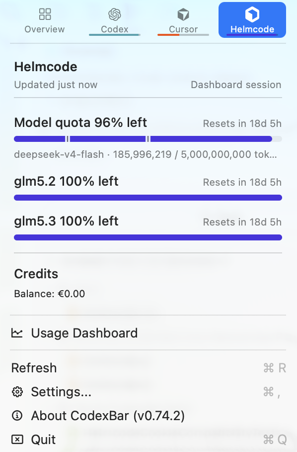

# Helmcode Cloud cookie import proof

## Final-app capture

I built and launched production commit `aa956e641c44baf42c28aaa447c4292f19d8e4dd` on October 13, 2026:

```sh
CODEXBAR_SIGNING=adhoc ./Scripts/compile_and_run.sh
```

The screenshot shows real dashboard usage, not fixture data. I cropped out the unrelated desktop and removed image metadata.



The capture shows:

- `Updated just now` and `Dashboard session`.
- Remaining quota values of 96%, 100%, and 100%.
- A prepaid balance of €0.00.
- CodexBar version 0.74.2.

The same checkout app, PID 8341, ran throughout the check. No `/Applications` copy ran. The app reports build 168.

The menu capture does not show the cookie-source setting. I separately verified these settings before the build, after permission, and at capture review:

```json
{"id":"helmcode","enabled":true,"cookieSource":"auto","region":"helmcode"}
```

The complete Helmcode configuration remained unchanged across those checks.

## Build identity

The source and app-bundle copies of `helmcode.js` matched byte-for-byte at launch and capture review. Their SHA-256 is:

```text
34a95122195a4a69fcac0c341a94711f8b7bd85f49403dc48560252587a0f796
```

The running executable's SHA-256 is:

```text
a58a2f56a29972d291b5f371a1122ad2ba05242b026097329be76d8f59677a31
```

This evidence covers the compatibility follow-up, not just the original host fix in `a23e72066`.

## Chrome import and cache reuse

The app started at 18:12:48 UTC. Its background refresh initially omitted Chrome access to avoid a Keychain prompt.

I then selected the explicit Helmcode refresh and accepted the macOS permission. The app recorded a fresh Chrome session and subsequent cache reuse:

```text
[2026-10-13T18:28:35.831Z] [DEBUG] com.steipete.codexbar.cookie-cache: Cookie cache miss provider=helmcode
[2026-10-13T18:28:45.953Z] [DEBUG] com.steipete.codexbar.cookie-cache: Cookie cache stored provider=helmcode source=Chrome Default
[2026-10-13T18:33:10.181Z] [DEBUG] com.steipete.codexbar.cookie-cache: Cookie cache hit provider=helmcode
[2026-10-13T18:43:45.959Z] [DEBUG] com.steipete.codexbar.cookie-cache: Cookie cache hit provider=helmcode
```

A read-only query of Chrome Default at 18:33:46 UTC selected only Cloud cookie hosts and names. It returned:

```json
[{"host":"cloud-api.helmcode.com","name":"__Host-session"}]
```

It returned no parent-host `__Host-session`. The query did not select cookie values or encrypted values.

The log does not report cookie domains or HTTP response status. The verified plugin, cookie-host metadata, and quota capture support the final-app runtime result together.

## Reconstructed cache regression

The compatibility tests use the production cookie broker with isolated cache storage, unavailable browser import, and fixture HTTP responses.

I recorded the new suite against the original production plugin from `a23e72066`, then against the corrected plugin in `aa956e641`:

| Scenario | Original patch | Compatibility follow-up |
| --- | --- | --- |
| Previous Cloud cache works without browser access and remains preferred over NaN | Failed on both engines | Passed on both engines |
| Rejection removes only the consumed previous Cloud entry | Failed on both engines | Passed on both engines |
| A late rejection preserves a newer entry in the previous scope | Failed on both engines | Passed on both engines |
| Current API-host cache works without a previous Cloud entry | Passed on both engines | Passed on both engines |
| Cached NaN fallback remains usable | Passed on both engines | Passed on both engines |
| Both manual tenants leave existing caches unchanged | Passed on both engines | Passed on both engines |

Recorded output:

- [Original-patch compatibility failures](helmcode-cookie-compatibility-red.txt).
- [Corrected compatibility and provider tests](helmcode-cookie-compatibility-green.txt).

Both engines are QuickJS and JavaScriptCore. Cookie-header values in the excerpts are redacted, including synthetic test values.

The broader focused run passed 110 tests in eight suites. `make check` passed.

The supported direct runner passed the complete inventory in 937.1 seconds:

```sh
PATH="/opt/homebrew/opt/python@3.13/libexec/bin:$PATH" \
  CODEXBAR_SUPPRESS_TEST_KEYCHAIN_ACCESS=1 \
  ./Scripts/test.sh --direct-workers 2
```

- Discovered and selected selections: 1,667.
- Successful groups: 150/150 on the first attempt.
- Failures, retries, and timeouts: zero.

The serial `make test` runner stopped with `Lost test session continuity`. The direct runner completed the same inventory with unchanged individual deadlines.

## Released storage contract

I compared v0.74.1, commit `7c08c0ae783b72040b728757eb85a6cfe4fc2443`, with `aa956e641` through local Git objects.

These files are byte-for-byte identical:

- `Sources/CodexBarCore/CookieHeaderCache.swift`.
- `Sources/CodexBarCore/KeychainCacheStore.swift`.
- `Sources/CodexBarCore/Config/CodexBarConfig.swift`.
- `Sources/CodexBarCore/Config/ProviderConfigCoding.swift`.

The shared broker differs from v0.74.1 due to base changes, but this PR does not change it. The plugin retains the previous Cloud scope through cached-only access; it does not rewrite stored sessions.

## Scope limits

- The ad-hoc app uses a process-memory cookie cache. This runtime check does not prove a persisted release-cache upgrade.
- The compatibility tests reconstruct previous cache entries; they are not a historical live upgrade.
- I did not run a live v0.74.1 upgrade with Cloud and NaN accounts.
- The unchanged-configuration check covers this build, not a v0.74.1 upgrade.
- The screenshot does not independently show Auto or an HTTP status.
- No cookie values, credentials, IP addresses, or account identity appear in these published artifacts.
